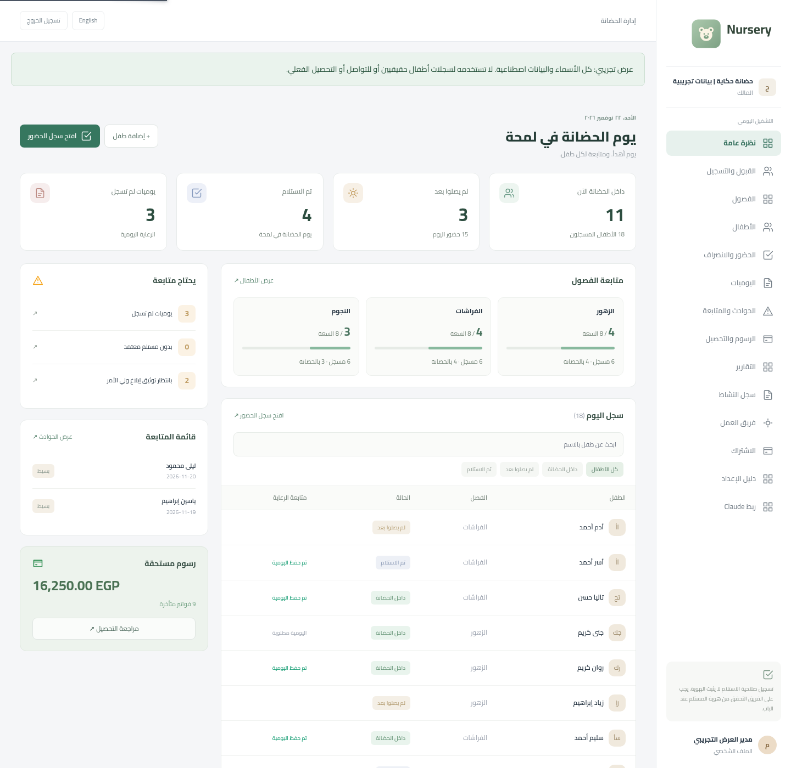
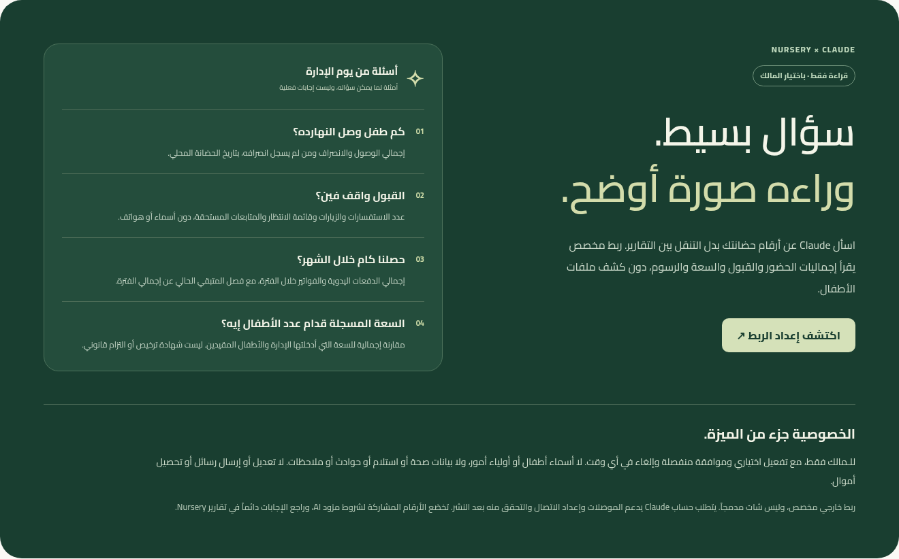

<div align="center">
  
  <h1>A calmer nursery day.</h1>
  <p>Arabic-first nursery operations, from the first inquiry to the last handover.</p>
  <p>حضور ورعاية وقبول ورسوم، في مساحة واحدة للحضانة.</p>
  <p><strong>Laravel 13</strong> · PHP 8.3+ · Vue 3 · Inertia · Arabic / English · RTL / LTR</p>
  <p><a href="#the-workspace">Workspace</a> · <a href="#claude-connection">Claude</a> · <a href="#quick-start">Quick start</a> · <a href="#configuration">Configuration</a> · <a href="#deployment">Deployment</a> · <a href="#testing">Testing</a></p>
</div>

---

## What Nursery is

A nursery day is a series of handovers. Who arrived? Who can collect them? Has the daily care record been saved? Which admissions need a call back? What has been collected, and what is still due?

Nursery keeps those records together, with access shaped around owners, managers and teachers. It is a multi-tenant application for private nurseries and preschools in Egypt and the Gulf, with a nursery-local timezone and an existing two-decimal fee ledger.

The interface is bilingual and responsive. The product does not replace staff identity checks, medical judgment, licensing requirements or safeguarding procedures.

## Screenshots

The workspace below uses synthetic demonstration data. It is not a real nursery or a testimonial.



## The workspace

| Area | Implemented workflow |
| --- | --- |
| Daily overview | Arrivals, children still on site, missing care records, pickup-list gaps and classroom capacity. Money is restricted to management. |
| Children and guardians | Child profiles, guardian links, classroom assignment, allergies and role-restricted general health notes. |
| Attendance and pickup | Nursery-local dates and a recorded handover to an active, child-specific authorized pickup person. |
| Daily care | Meals, naps, mood, activities and notes, with validation, saved state and unsaved-change indicators. |
| Admissions | Inquiries, visits, waitlists and follow-ups. Confirmed enrollment creates one child and guardian link without silently granting pickup permission. |
| Billing | Tuition plans, draft/sent/paid/void invoices, exact two-decimal parsing, manually recorded payments and overpayment protection. |
| Reports | Date-range arrivals, care logs, collections and ledger trends, with current outstanding fees labeled separately. |
| Team and history | Owner-managed staff roles and tenant-scoped administrative activity history. |
| First-run guide | Saved nursery details, rooms, first child/guardian and pickup setup, with continue-later and revisit support. |
| Commercial platform | A separate platform guard, sales inquiry inbox, configurable plans and explicit manual activation/renewal. No prices or trials are invented. |

### Boundaries that matter

- A guardian link is **not** pickup permission. A recorded pickup permission is **not** physical identity verification.
- Teachers can see safety-critical allergies, but not general medical notes, billing totals or prospective-family contacts.
- Operational records are tenant-scoped. Cross-tenant identifiers are rejected rather than redirected to another nursery's record.
- Classroom capacities are entered by the nursery. They are not a legal staffing or licensing assessment.
- Payments are manual records. No online gateway, automatic charge or external family messaging is implemented.
- New registrations start pending/read-only. They do not receive an implied free trial or paid plan.

## Claude connection

Ask an external Claude account about aggregate nursery records through a custom, read-only MCP connection. This is not an embedded chatbot or a public connector-directory listing.



| Tool | What it returns |
| --- | --- |
| `attendance_summary` | Arrival, departure and not-yet-checked-out counts on a nursery-local date, with current enrollment labeled separately. |
| `classroom_occupancy` | Aggregate entered capacity, classroom count and current assigned/unassigned enrollment. |
| `admissions_summary` | Counts by admission stage and due follow-ups. |
| `fees_summary` | Manual collections and issued fees for a bounded range, with current outstanding fees separately labeled. |

**No child or guardian identities, contacts, health records, pickup details, incidents or free-text notes are exposed through these tools.** No tool changes a record or sends a message.

An owner must first enable access with their password and an explicit data-sharing acknowledgment. Each connection then has its own consent screen. OAuth uses authorization code + PKCE S256, hashed access/refresh tokens, refresh rotation and revocation. Access is bound to the approving owner, nursery and host; role loss, tenant changes, expiry, disabling AI and ineligible subscription status stop reads. Disabling access also revokes outstanding connections.

After deployment on HTTPS:

1. The owner opens **Claude connection** in Nursery and enables connections.
2. In a Claude account that supports custom connectors, add the exact `/mcp` address shown in Nursery.
3. Sign in to Nursery and review the nursery, account, requesting app and aggregate scope before consenting.
4. Ask a question, then check the answer against Nursery reports. Disconnect from Nursery when finished.

Requested aggregates go to the external AI provider under the user's account terms. Revocation stops future access, not past conversations. Account availability and a successful connection on a particular deployment still need live verification. No paid AI API is required by this server implementation.

## Stack

| Layer | Technology |
| --- | --- |
| Server | PHP 8.3+, Laravel 13, Sanctum |
| UI | Vue 3, Inertia, Tailwind CSS, bundled Cairo font |
| Data | MySQL-compatible database; upgrade tests verified on MariaDB 10.6.23 |
| Authentication | Nursery user roles plus a separate platform-administrator guard |
| AI access | Read-only JSON-RPC/MCP over HTTP, OAuth authorization code + PKCE |
| Assets | Vite, built before deployment |

### Repository layout

| Path | Purpose |
| --- | --- |
| `app/Http/Controllers` | Nursery workflows, commercial administration and connector endpoints |
| `app/Models` | Tenant-owned records and access relationships |
| `resources/js` | Bilingual product UI and landing page |
| `database/migrations` | Forward-only schema changes for existing installations |
| `tests` | Role, tenant, workflow, monetary, setup, demo and connector regression tests |
| `docs` | Deployment, data model, product plan and competitor evidence |

## Quick start

Use PHP 8.3+ with Composer, Node 22.12+ and a MySQL-compatible database. Production dependencies are pinned to a PHP 8.3 platform target; do not replace the lock with a resolution made for a newer PHP runtime.

```sh
git clone https://github.com/SalemAshraf/rawda-nursery.git
cd rawda-nursery
cp .env.example .env
# Set DB_CONNECTION=mysql and your local DB_* values.
composer install
php artisan key:generate
npm ci
npm run build
php artisan migrate
php artisan serve
```

Open the local address printed by Artisan. Register a nursery account to inspect the pending/setup workflow. Manual activation is a separate administrative decision, not evidence of payment.

## Configuration

| Variable | Purpose |
| --- | --- |
| `APP_NAME`, `APP_URL` | Product label and exact application origin. Connector metadata uses this origin. |
| `APP_ENV`, `APP_DEBUG` | Use production / false on a live deployment. |
| `APP_KEY` | Generate a unique key for each installation; never commit it. |
| `DB_CONNECTION`, `DB_*` | Isolated database and least-privilege application credentials. |
| `SESSION_COOKIE`, `SESSION_DOMAIN` | Distinct host-only session cookie; avoid sharing sessions with sibling applications. |
| `SESSION_SECURE_COOKIE` | Enable for an HTTPS deployment. |
| `SESSION_DRIVER`, `CACHE_STORE` | Database defaults have migrations included. |
| `MAIL_MAILER` | Keep `log` until real email delivery is configured and approved. |

Use [`.env.production.example`](.env.production.example) as a placeholder-only deployment template. Secrets belong in the deployment environment, never source control or screenshots.

## Deployment

Serve only `public/`. Keep `.env`, application source, storage and database credentials outside the web document root. Use a separate app directory, database and database user. Build vendor/assets before uploading to a host without Composer or Node.

For an **existing** installation: back up the database, preserve `.env`, existing data and storage, install the reviewed locked dependencies/build and run `php artisan migrate --force`. Never use `migrate:fresh`, reset migrations or demo seeds on an existing nursery.

No queue or scheduled application work is required by the implemented workflows. Verify the host's PHP extensions, HTTPS redirects, asset URLs, sessions, CSRF and OAuth behavior on the actual deployment. A successful command-line health check is not a browser or Claude connection test.

See [deployment instructions](docs/deployment.md) and [commercial administration](docs/commercial-platform.md).

### Synthetic demonstration nursery

The versioned `nursery:demo` command creates a separate, clearly labeled synthetic nursery with 18 children, three classrooms, guardian/pickup examples, recent attendance and care, admissions and manual fee records. It does not send messages, create a real business administrator or overwrite existing records. Re-running it refuses an existing demo/login.

An operator supplies an explicitly synthetic `.test` email and a protected file containing a securely provisioned password of at least 12 characters:

```sh
php artisan nursery:demo --confirm-synthetic --email=owner@nursery.example.test --password-file=/protected/path/password
```

Delete the temporary credential file after use. No default demo password is published. The demo is for inspection, never real child records. The older development seeder refuses to run in production.

### Platform administrator

Platform administration is separate from a nursery demo account. Create one only after the actual operator's identity is chosen:

```sh
php artisan platform:admin APPROVED_EMAIL --name=APPROVED_NAME
```

The command asks for a password through hidden prompts, requires at least 12 characters and refuses an existing administrator. No real administrator, prices, plans or trials are seeded.

## Testing

Feature tests use a dedicated MySQL-compatible test database, configured in `phpunit.xml`. Never point tests at an installation with real records.

```sh
php artisan test
npm run build
```

The latest implementation check passed **96 tests / 675 assertions** on PHP 8.3.32 and MariaDB 10.6.23. Coverage includes tenant and role negatives, exact money, pickup authorization, idempotent enrollment, pending/expired subscriptions, setup progress, synthetic demo isolation, OAuth replay/revocation and aggregate privacy exclusions. This is test evidence, not a claim of full production or legal readiness.

## Current limits

Parent accounts/apps, automatic family messaging, online payments, recurring collections, medication workflows, transport tracking, staff scheduling and multi-branch management are not implemented. Staff-recorded incident acknowledgment is not a guardian's digital signature. Three-decimal Gulf currencies need a separately reviewed ledger migration; the current ledger is two-decimal.

## Further reading

- [Commercial platform and setup](docs/commercial-platform.md)
- [Competitor-grounded priorities](docs/competitor-priorities-2026-11.md)
- [Market study](docs/market-study.md)
- [Data model](docs/database.md)
- [Product plan](docs/plan.md)
- [Third-party notices](THIRD_PARTY_NOTICES.md)

## Rights

Nursery application code is proprietary, all rights reserved. Source visibility does not grant a new reuse license. Third-party dependencies retain their own licenses. No license or branding from a reference project is adopted by this README.
